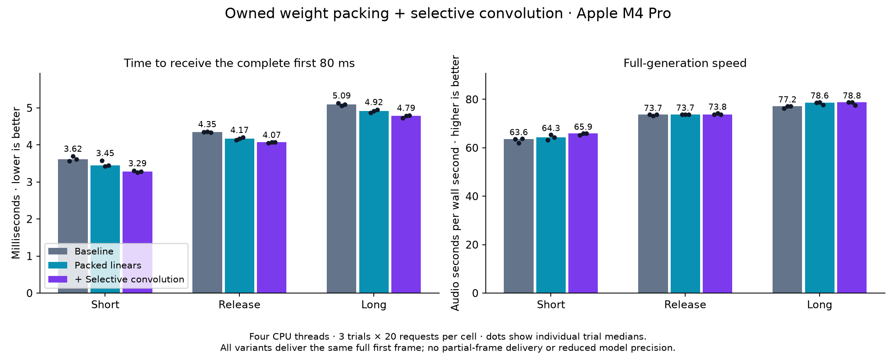

# Owned CPU packing and selective Mimi convolution

This continues the [first-frame study](../../mimi-rnd/m4-pro-2026-11-01/README.md).
It replaces Phonon's private kernel bindings with a reusable xn backend operator,
removes avoidable input/output copies, reuses scratch memory and tests prepacking
the first waveform convolution. The selected candidate emits the **complete first
80 ms frame**, without partial-frame delivery, reduced precision or fewer sampling
steps. All new inference paths remain opt-in.

Final single-stream median TTFA improves **6–9%**, saving about **0.3 ms** on the
tested texts. Four-stream median TTFA improves 9.3%, with aggregate generation
speed up 3.7% in that cohort. The price is 31 MiB of retained packed weights and
about 4 ms of additional model-loading time. This supports a reusable backend
contribution, while the tail and memory tradeoffs argue against an unconditional
default change.

This is incremental inference work on an Apple M4 Pro, not a claim of a large
application-level latency reduction. The remaining limitations, rejected variants
and individual slow requests are retained alongside the favorable medians.

## Implementation

The backend fork provides
[`cpu_backend::packed::PackedF32`](https://github.com/rudrakshkarpe/xn/blob/perf/owned-f32-packing/docs/packed-f32.md).
It snapshots constant f32 weights and optional bias, checks dimensions before
native access and uses existing KleidiAI SME2 kernels. The application owns the
packed matrix and reusable scratch explicitly. Original weight mutations cannot
invalidate a packed snapshot; dropping it frees its storage. Concurrent calls share
immutable weights and use separate scratch. Unsupported builds/CPUs return `None`
from construction so callers can keep their ordinary operators. Thread-dependent
SME tile sizes are checked before using the packed layout.

Phonon's adapter borrows contiguous CPU f32 input storage directly, writes directly
into output storage and keeps scratch in its decoder worker's thread-local state.
No global packed-weight cache or raw private kernel symbol is used by this adapter.
The standalone historical kernel probe still binds symbols for its microbenchmark.

The final adapter initializes CPU output buffers directly. The intermediate version
used `Tensor::zeros`, whose 32,768-element threshold can dispatch a fill to the
shared worker pool immediately before the matrix operation overwrites it. The
change avoids that dispatch; it does not redesign the pool or change OS priorities.
The final benchmark measures the complete candidate, not an isolated attribution
of every microsecond to this allocation change.

The convolution prototype lowers NCL input into dense matrix rows, applies the
packed operator and restores NCL output. Tests cover stride, dilation, batching,
odd dimensions and small tails. It retains the original bias-add semantics.
The selected route applies only to the decoder's initial convolution and only
when its output has at most 16 timesteps. Larger batches use the existing path.
The threshold and parameter-path selection are explicit research choices for this
checkpoint, not a universal convolution dispatch policy.

The backend dependency is pinned to `7363979dd2c8ff1c0beb3a023bd176901872922f` in
both workspace and QNN text-wrapper lockfiles. This research branch depends on a
fork; it does not imply the API has been accepted or released upstream.

## Final measurements



| Text | Variant | Whole-frame TTFA p50 | TTFA p95 | RTFx p50 |
|---|---|---:|---:|---:|
| short | baseline | 3.617 ms | 3.824 ms | 63.58 |
| short | packed | 3.450 ms | 3.595 ms | 64.34 |
| short | packed-conv-small | 3.286 ms | 3.424 ms | 65.91 |
| release | baseline | 4.347 ms | 4.480 ms | 73.67 |
| release | packed | 4.168 ms | 4.383 ms | 73.69 |
| release | packed-conv-small | 4.070 ms | 4.217 ms | 73.81 |
| long | baseline | 5.090 ms | 5.226 ms | 77.18 |
| long | packed | 4.922 ms | 5.126 ms | 78.59 |
| long | packed-conv-small | 4.791 ms | 5.383 ms | 78.78 |

The selected candidate reduces median full-frame TTFA by 9.2%, 6.4% and 5.9% on
the short, release and long texts. That saves approximately 0.28–0.33 ms per request.
Median RTFx increases by 3.7%, 0.2% and 2.1%; this is mainly a startup-latency
improvement. Long-text TTFA p95 regresses from 5.226 to 5.383 ms, so the gain is
not uniform at the tail. All final single-stream requests receive the same first
80 ms at their first PCM arrival: first-20-ms and first-80-ms times are equal.

The baseline contains the earlier discarded-prefill-output optimization, with all
packing/splitting/scheduling experiment flags disabled. It does not contain the
voice-cache LRU change. These are incremental gains; do not add percentages from
separate experiments to claim an overall improvement against stock upstream.

Four-thread final matrix: three texts × three variants × three fresh-process trials,
twenty requests and five warmups per process. Values are medians of per-trial
statistics, not pooled percentiles. Variant order rotates/reverses and text order
rotates. Exact texts, commands, binary hashes and every request are retained in
[the manifest](final/manifest.json), [summary](final/summary.json) and
[observations](final/observations.jsonl). Initial model loading and one-off voice
conditioning are excluded. Text preparation and delivery through `Synth::stream`
are included. There is no HTTP transport or device playback measurement.

This is an interactive desktop without thermal/clock isolation. Timing runs do not
overlap compilation, profiling or audio capture. RTFx is generated audio seconds
divided by generation wall seconds; it is not a concurrent serving-capacity metric.

## Concurrent streams and scheduler investigation

Final adapter, four concurrent streams, release sentence, 360 measured requests:

| Variant | Per-request TTFA p50 | TTFA p95 | Aggregate RTFx |
|---|---:|---:|---:|
| baseline | 6.008 ms | 6.715 ms | 123.41 |
| packed | 5.651 ms | 6.118 ms | 123.35 |
| packed-conv-small | 5.451 ms | 6.289 ms | 128.03 |

The combined candidate lowers median startup latency by 9.3% and increases
aggregate RTFx by 3.7% in this cohort. Packed linears alone do not improve
aggregate throughput. This is a small capacity gain on this workload, not a
general scaling claim. [Final concurrency data](final-concurrency4/manifest.json).

One-thread release-text validation (180 requests) gives 4.745 ms baseline,
4.449 ms packed and 4.370 ms combined full-frame TTFA (−7.9% combined).
Median RTFx is 58.49, 60.01 and 59.84 respectively.
[One-thread details](final-one-thread/summary.json).

Each concurrency round starts simultaneous requests against one shared, loaded
`Synth`, with its voice already warm. Per-request timings start after the round's
barrier. Aggregate RTFx is total audio duration divided by round wall time including
outer thread creation and joining; the reported statistic is the median of the
three trial aggregate rates. This is a synchronized burst experiment, not a
server benchmark with an arrival process, queuing policy or admission controller.
Capacity and startup-latency effects must be assessed separately.

Across the 1,080 final and 1,260 intermediate timing requests, the offline 20-ms
playback-buffer simulation reported no underruns. That does not mean there were
no slow requests: the intermediate four-stream candidate had a 68.80 ms TTFA
outlier. In the final single-stream cohort, the candidate's worst TTFA was
8.06 ms and its slowest long-text generation took 414.94 ms. In the final
four-stream cohort the worst TTFA was 7.70 ms, in the baseline. All are included
in the committed observations. The manifests separately count timing, warmup,
smoke and diagnostic runs; see [study manifest](manifest.json).

The earlier [two-stream](concurrency2/summary.json) and
[four-stream](concurrency4/summary.json) matrices used the intermediate adapter
before direct output initialization. They are retained as exploratory evidence,
not substituted for the final cohort.

An independent diagnostic run records cumulative process user/system CPU time
and voluntary/involuntary context switches at request start and each PCM arrival.
It is deliberately excluded from performance claims because the sampling adds
overhead. All process workers contribute to CPU time; it can exceed wall time.
The 240 diagnostic requests had no simulated underruns. The largest inter-chunk
wall gaps were 15.89 ms baseline and 15.41 ms candidate, while process CPU advanced
55.93 and 53.61 ms respectively. Those gaps show ongoing multi-thread CPU work;
they do not identify the cause of the much longer stalls in the previous study.
[Raw diagnostic records](runtime-diagnostic/observations.jsonl).

The earlier study's four underruns remain unresolved, not erased by later clean
runs. No real-time guarantee, production default or universal tail improvement is
claimed. No new spin-budget, affinity, priority or first-frame-gate policy is enabled.

## Convolution ablations and profiles

Applying packed convolution broadly was a loss in the eight-request smoke probe:
baseline 4.532 ms TTFA / 73.348 ms generation; all-convolution packing
5.244 / 137.690 ms; packed linears plus all convolutions 4.979 / 132.749 ms.
These exploratory numbers are not a controlled final speedup estimate. They show
why matrix microbenchmarks are insufficient: lowering and output layout conversion
can outweigh matrix savings. [Smoke measurements](smoke/summary.json).

Packing only the first convolution for every batch improved TTFA but was less
attractive for long-utterance generation: intermediate long-text p50 generation
207.882 ms baseline, 209.982 ms always-packed initial convolution, 203.370 ms
small-step dispatch. All three had packed-linears enabled except the baseline.
The same first-frame kernel is used in the two convolution candidates; small TTFA
differences between them across processes should not be attributed to the later
batch threshold. [Full ablation matrix](main/summary.json).

| First-frame host stage | Baseline | Packed linears | + Selective convolution |
|---|---:|---:|---:|
| mimi_decode | 1.893 ms | 1.708 ms | 1.569 ms |
| mimi_transformer | 0.868 ms | 0.681 ms | 0.672 ms |
| mimi_waveform_decoder | 0.972 ms | 0.992 ms | 0.855 ms |
| mimi_initial_conv | 0.304 ms | 0.314 ms | 0.183 ms |

In the selected first convolution, lowering takes 0.034 ms, the packed matrix
operation 0.124 ms and output-layout restoration 0.007 ms. The waveform stages
after that convolution are broadly unchanged. The trace locates the saving in
Mimi rather than shifting a first-audio timestamp.
[Baseline spans](baseline-stages.json), [packed spans](packed-stages.json),
[combined spans](packed-conv-small-stages.json); compressed raw Chrome traces:
[baseline](baseline-trace.json.gz), [packed](packed-trace.json.gz),
[combined](packed-conv-small-trace.json.gz).

Profiles are inclusive host spans, ten measured requests after three warmups.
Child spans must not be added to their parents. Tracing adds overhead; use untraced
matrices for speedup claims. The stage summarizer keeps the first occurrence of
each name per request. This study does not claim a new assembly kernel, general
convolution replacement or modification to the existing fused attention kernel.

## Output, memory and validation

All twenty final candidate comparisons had matching lengths and finite samples.
Packed-linears maximum absolute sample error was 1.68e-6 (minimum SNR 126.67 dB);
the combined candidate was 2.26e-6 (minimum SNR 120.63 dB). Baseline-repeat maximum
error was 1.52e-6. [All comparisons](audio-final/report.json).

“Hey Gradium team, this is Rudraksh loving the phonon so far!”:

* [Baseline audio](audio-final/sample-baseline.wav)
* [Packed-linears audio](audio-final/sample-packed.wav)
* [Combined candidate audio](audio-final/sample-packed-conv-small.wav)

The combined candidate retains **32,544,768 bytes (31.04 MiB)** of packed weights:
24.04 MiB for eight transformer linears and 7.00 MiB for the initial convolution.
Original weights remain available; larger convolution inputs still use them.
Fresh-process resource probes show median peak RSS **351.16→386.69 MiB** and
model-loading time **42.1→46.4 ms**. Peak RSS includes scratch, allocator and other
process state, so its change need not equal the retained-weight allocation.
The extra 4.3 ms occurs at model loading, outside the warm TTFA measurements.
[Resource observations](resources/results.json).

Waveform checks use five sentences, two distinct voices, both candidates and a
fresh baseline repeat for each text/voice. They compare full float32 output, with
unchanged seed, precision and sampling. These are numerical checks, not MOS,
ASR/WER or a human listening panel. The baseline itself can vary slightly because
decoder batching depends on scheduling. Saved WAVs use the same mono 24 kHz PCM16
conversion without added normalization.

The xn CPU test suite passed 224 tests, including native packed-matrix checks.
Separate tests passed with the native kernel disabled and with the `kai` feature
absent. Phonon passed 143 tests including doctests, plus checkpoint streaming-state
and cancellation checks with the packed paths enabled. Clippy and no-default-feature
compilation passed; Phonon's Clippy run retains the existing `nonminimal_bool`
exception. The QNN text wrapper also compiles with its updated lockfile. CUDA,
Metal, other chips and other checkpoints were not validated.

The native tests cover odd dimensions, biases, snapshot semantics, repeated
different row counts, empty rows, invalid lengths and concurrent callers with
independent workspaces. Convolution tests check layout equivalence, and checkpoint
tests check later streaming state after split calls. No model weights are downloaded
by these tests. [Validation logs](validation/).

## Reproduce and next decision

From the checkout, set `ROOT` to the folder containing `models/phonon-31m-en`.
All timing commands should run sequentially and use a fresh results directory.

```sh
cargo build -p ptts --release --locked --features hf,accelerate,kai --example bench
python3 scripts/bench-mimi-research.py --root "$ROOT" --binary target/release/examples/bench --out "$ROOT/results/owned-final" --variants baseline,packed,packed-conv-small --trials 3 --iters 20
python3 scripts/bench-mimi-research.py --root "$ROOT" --binary target/release/examples/bench --out "$ROOT/results/owned-c4" --variants baseline,packed,packed-conv-small --texts release --concurrency 4 --trials 3 --iters 10
python3 scripts/bench-mimi-research.py --root "$ROOT" --binary target/release/examples/bench --out "$ROOT/results/owned-cpu" --variants baseline,packed-conv-small --texts release --runtime-diagnostics --trials 1 --iters 120
python3 scripts/check-mimi-audio.py --root "$ROOT" --binary target/release/examples/bench --out "$ROOT/results/owned-audio" --variants packed,packed-conv-small --voice "$ROOT/models/voices/voices/0zLApsZfVLLNaEGl.safetensors"
python3 scripts/mimi-resource-probe.py --root "$ROOT" --binary target/release/examples/bench --out "$ROOT/results/owned-memory" --candidate packed-conv-small
```

The selected candidate uses `PTTS_EXPERIMENT_PACKED_MIMI=1` and
`PTTS_EXPERIMENT_PACKED_CONV=initial-small`. All other experiment flags should be
unset. `initial` and `all` remain available for ablations. The scripts clear
experiment flags between variants. Adapt executable paths when using
`CARGO_TARGET_DIR`. The first Cargo git-dependency fetch also retrieves xn's
existing Cutlass submodule; the experiments themselves use only the Mac CPU.

The clean upstream contribution is the explicit owned packed-matrix API. The
Phonon shape-specific convolution adapter remains experimental. Before enabling
it by default, validate sustained service load and tail behavior, extend the
checkpoint/hardware coverage and settle the backend API with its maintainers.
