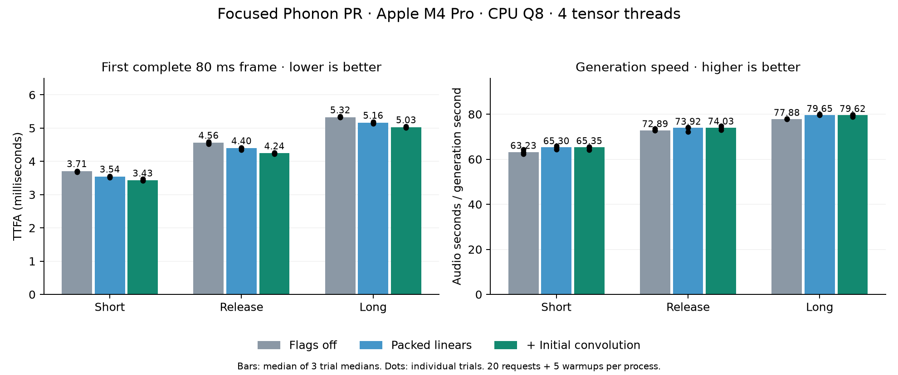

# Focused upstream PR validation on Apple M4 Pro

This validates the clean `perf/mimi-packed-operators` branch based directly on
upstream `31e4e9f80275e432b570e17f5ccbefa895eff109`. It contains the packed Mimi
adapter, selective initial convolution, operator/state tests and minimal benchmark
exports. It does not contain the separate prefill optimization, voice-cache LRU,
partial-frame delivery or scheduler experiments from the research branches.

Measured source: [`ddf1ecdfd6716a429ecad4e9ad29f083d42f795d`](https://github.com/rudrakshkarpe/xn-ptts/commit/ddf1ecdfd6716a429ecad4e9ad29f083d42f795d).
Later documentation-only commits do not change this implementation.
Backend API: `7363979dd2c8ff1c0beb3a023bd176901872922f`, submitted in
[xn #134](https://github.com/gradium-ai/xn/pull/134). The temporary fork pin must be
replaced with an accepted upstream revision/release before the Phonon PR merges.

## Results

Across **540 measured requests and 135 warmups**, the selected combined candidate
improves median complete-first-frame latency by **7.6%, 7.0% and 5.6%** on short,
release and long texts. The absolute savings are 0.281, 0.320 and 0.298 ms.
Median RTFx improves 3.4%, 1.6% and 2.2%. This is an incremental startup improvement
on an already fast native stack.



| Text | Variant | TTFA p50 (ms) | TTFA p95 (ms) | RTFx p50 | Worst individual TTFA (ms) |
|---|---|---:|---:|---:|---:|
| short | baseline | 3.706 | 3.902 | 63.23 | 4.997 |
| short | packed | 3.545 | 3.658 | 65.30 | 3.721 |
| short | combined | 3.425 | 3.625 | 65.35 | 4.783 |
| release | baseline | 4.561 | 4.884 | 72.89 | 6.699 |
| release | packed | 4.396 | 4.738 | 73.92 | 5.083 |
| release | combined | 4.241 | 4.537 | 74.03 | 4.762 |
| long | baseline | 5.324 | 5.602 | 77.88 | 11.397 |
| long | packed | 5.162 | 5.415 | 79.65 | 5.987 |
| long | combined | 5.025 | 5.166 | 79.62 | 5.279 |

`baseline` has both flags unset. `packed` sets
`PTTS_EXPERIMENT_PACKED_MIMI=1`. `combined` additionally sets
`PTTS_EXPERIMENT_PACKED_CONV=initial-small`. All variants use the same binary.
The baseline uses upstream's ordinary inference algorithms with the optional
adapter disabled, not a separate stock-upstream binary.

p50 and p95 cells are medians of three per-trial statistics, not pooled percentiles.
Each trial has 20 requests after five warmups in a fresh process. p50 is the median;
p95 uses the nearest index to `0.95 * (n-1)`. The final column is the worst individual
request across all trials. Variant order rotates/reverses and text order rotates;
all measurements run sequentially, without concurrent builds or profiling.
The graph shows trial p50s, not confidence intervals.

All 540 requests delivered at least 1,920 samples in their first chunk at 24 kHz:
**the complete first 80 ms of audio**. The JSON contains every chunk's arrival and
sample count, checked against total generated samples. No chunk splitting or
changed timestamp boundary contributes to the result.

The current p95s improve, but the earlier research cohorts had mixed tails and
occasional stalls. The baseline here also had an 11.40 ms TTFA outlier. These runs
do not establish production p99, sustained service capacity or a real-time guarantee.

## Measurement boundary and environment

Apple M4 Pro, 12 logical CPUs, 24 GiB RAM, macOS 27.0.1, Rust 1.92.0, native CPU
release build with `hf,accelerate,kai`; four tensor threads, `XN_KAI=1`, seed 42,
default temperature 0.3, Phonon 31m English Q8. The desktop is not thermally or
clock isolated. The checkpoint, config, tokenizer, voices and binary hashes,
exact inputs and every command are in the [timing manifest](timing/manifest.json).
Binary SHA-256: `0963ce4a4ba435f54fe67572c39ac892eb185ca14254852e0c9ee53194080935`.

Timing starts before `Synth::stream_with` and ends on first nonempty PCM arrival
at its caller. Initial model loading and voice conditioning are excluded. Text
preparation is included. There is no HTTP client, network, playback device or
server admission queue. RTFx is generated audio duration divided by generation
wall time; it is not a concurrent capacity measurement.

[Trial summaries](timing/trial-stats.json) · [All request/chunk observations](timing/observations.jsonl) · [Aggregate table](timing/summary.json).
The timing directory also keeps every per-process JSON and stdout log.

## Audio checks and samples

Five sentences and two distinct voices were each generated with baseline, a
baseline repeat, packed linears and the combined candidate, in fresh processes.
These runs are separate from timing, with two warmups and one recorded output.
All **20 candidate comparisons** had matching lengths and finite samples.

| Comparison | Maximum absolute sample difference | Minimum SNR |
|---|---:|---:|
| Baseline repeat | 1.044e-6 | 126.74 dB |
| Packed linears | 1.044e-6 | 126.28 dB |
| Combined candidate | 1.684e-6 | 126.59 dB |

These are float32 numerical comparisons, not bit-identity, MOS, ASR/WER or blinded
listening scores. Seed and model precision are unchanged. Scheduling can change
Mimi's batch lengths, so even repeated baseline output can differ slightly.
[All comparisons](quality/report.json) · [Commands and asset hashes](quality/manifest.json).

“Hey Gradium team, this is Rudraksh loving the phonon so far!”:

- [Baseline](quality/sample-baseline.wav)
- [Baseline repeat](quality/sample-repeat.wav)
- [Packed linears](quality/sample-packed.wav)
- [Combined candidate](quality/sample-combined.wav)

WAVs use identical mono 24 kHz PCM16 conversion without added normalization.

## Cost and earlier profiling

The prior [research report](../m4-pro-2026-11-01/README.md) records 31.04 MiB of
retained packed weights, about 4.3 ms extra model-loading time, component profiles,
concurrent-stream runs and rejected broad convolution packing. Those resource and
concurrency numbers were measured on the research build and were not remeasured
here. This PR retains the same selected weights; original weights remain for
fallback. Both new paths are opt-in.

The generic owned operator reuses existing KleidiAI SME2 kernels; this is not new
assembly. Shape selection is specific to the tested Mimi checkpoint. Other chips,
checkpoints and GPU execution have not been locally validated.

## Validation

On the focused PR branch:

- 144 ptts tests passed, including doctests; one model-dependent test was ignored
  by the normal suite. The separate audio runs above exercise the real checkpoint.
- Native adapter tests cover odd shapes, varying rows, strides, dilation and batches.
  A streaming test crosses the 16-step threshold in both directions and verifies
  bias, output, retained causal state and the first-call marker.
- Three packed tests passed without `kai` and with `XN_KAI=0` (fallback checks).
- Workspace `cargo check --locked`, QNN text-wrapper check, formatting and diff checks passed.
- ptts all-target Clippy passed with the existing upstream `nonminimal_bool`
  exception; xn all-target Clippy passed with `-D warnings`.

[Saved validation logs](validation/). Native tests cannot exercise SME2 arithmetic
on CI runners without that hardware.

## Reproduce

Build the focused branch:

```sh
cargo build --locked -p ptts --release --features hf,accelerate,kai --example bench
```

Set `ROOT` to the local directory containing `models/phonon-31m-en`, `SOURCE` to
the focused PR checkout, and `BIN` to its built bench executable. Run this report's
standard-library harness with a fresh output directory:

```sh
python3 reproduce.py --root "$ROOT" --source "$SOURCE" --binary "$BIN" --out /tmp/packed-timing --mode timing
python3 reproduce.py --root "$ROOT" --source "$SOURCE" --binary "$BIN" --out /tmp/packed-quality --mode quality --voice /path/to/second-voice.safetensors
```

The harness fails on missing audio, sample-count mismatch, incomplete first-frame
delivery or waveform error above 1e-5. Charts can be regenerated with `plot.py`
using Matplotlib. No model is downloaded by the scripts.
