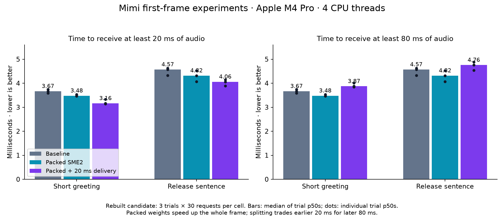
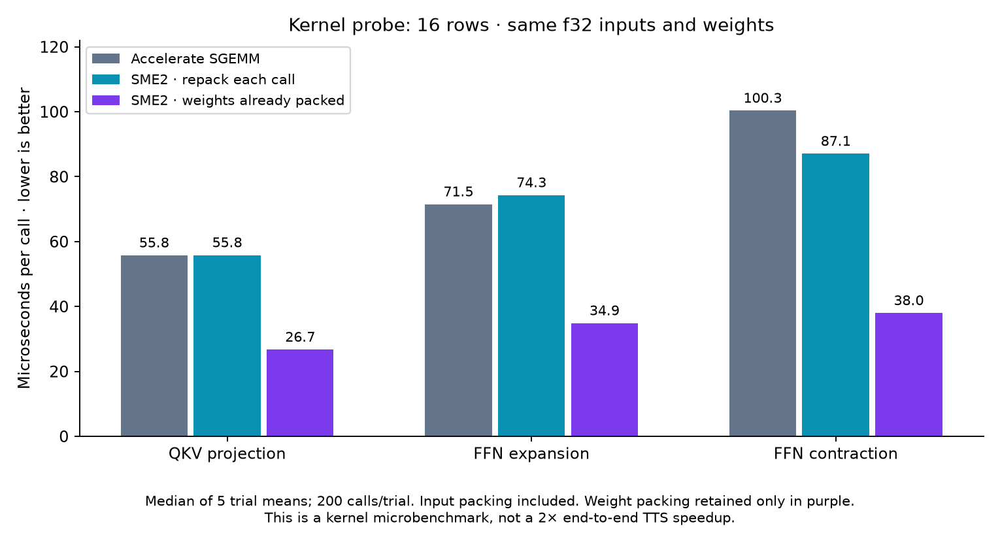

# Mimi first-frame delivery, kernels and scheduling on Apple M4 Pro

The strongest general inference result is **packing Mimi's constant f32 linear
weights once and reusing existing KleidiAI SME2 kernels**. In the rebuilt candidate,
whole-first-frame TTFA improves by about 5% on two ordinary warm-voice texts.
Delivering the first 20 ms separately improves first-piece latency further, but
delays receipt of the complete 80 ms frame. Scheduler ablations do not justify
changing the existing defaults.

These are opt-in research prototypes, not production defaults. No new assembly
kernel was invented: the contribution is identifying and removing repeated layout
preparation, selecting an existing matrix kernel, and validating it in real TTS.
The saved results cover 3,060 measured requests and 570 warmups. This is worthwhile
incremental backend work; it is not a demonstrated 2× TTS speedup or a large
perceptual latency improvement. The absolute savings are fractions of a millisecond.

## Baseline and measurement boundaries

Baseline: `97ac4980ddaf31f4cab71cc2a92ab9ee6c2821ff`, including the earlier
[discarded-prefill-output optimization](../../ttfa-rnd/m4-pro-2026-11-01/README.md).
It does not include the separate voice-cache LRU patch. Both variants use the same
binary, checkpoint, voice, seed, thread count and arrival instrumentation. All
experiments are disabled for the baseline. These gains are incremental to the
earlier prefill optimization; percentages from different runs must not be added.

Implementation: `7a25ee278acd4d241e1267d8553cff3df12bf848`.
Apple M4 Pro, 12 logical CPUs, 24 GiB RAM, macOS 27.0.1; Rust 1.92.0,
`hf,accelerate,kai`, native CPU target, xn 0.2.13. Phonon 31m English q8 checkpoint,
seed 42, default sampling settings and voice. Mimi's relevant matrices remain f32.
See [manifest](manifest.json) for exact checkpoint/backend revisions.

Measured interval: normal `Synth::stream` call through PCM delivery to the caller,
including text preparation. Model loading and one-off voice conditioning are
excluded and reported separately. No HTTP transport, STT/LLM, device playback,
cloud GPU, CUDA or Metal is involved. The desktop is not thermally/clock isolated.

Each table cell is the median of three per-trial p50 or p95 statistics, not a pooled
percentile. Fresh processes, five warmups/process, rotating/reversed variant order;
no compilation, profiling or audio capture during timed matrices. Thirty measured
requests/trial in the rebuilt confirmation, twenty in the earlier matrices. All
observations, including noisy trials, are retained. Three trials and one desktop
are insufficient for population-level confidence or broad hardware claims.

## 1. Whole-frame speedup and earlier partial delivery



Rebuilt-candidate confirmation, four threads, 540 measured requests:

| Text / variant | First 20 ms p50 | First 20 ms p95 | First 80 ms p50 | RTFx p50 |
|---|---:|---:|---:|---:|
| Short / baseline | 3.667 ms | 4.562 ms | 3.667 ms | 62.81 |
| Short / packed weights | 3.480 ms | 3.733 ms | 3.480 ms | 64.08 |
| Short / packed + waveform split | 3.163 ms | 3.892 ms | 3.874 ms | 63.72 |
| Release sentence / baseline | 4.571 ms | 4.758 ms | 4.571 ms | 71.51 |
| Release sentence / packed weights | 4.317 ms | 4.704 ms | 4.317 ms | 72.37 |
| Release sentence / packed + waveform split | 4.060 ms | 4.391 ms | 4.757 ms | 72.66 |

Packed weights reduce whole-frame p50 by 5.1% and 5.6%. The combined split reduces
first-20-ms p50 by 13.7% and 11.2%, but first-80-ms delivery is 0.207 and 0.186 ms
later than baseline. It is a delivery tradeoff, not equivalent to computing the
entire frame that much faster. RTFx is generated audio seconds / generation wall
seconds, higher is better. It measures one request, not concurrent server capacity.
The small median RTFx gains do not establish a general throughput improvement:
release-sentence packed full-generation p95 regresses from 78.85 to 101.35 ms in
this confirmation. Individual trials vary appreciably.

[Confirmation summary](final-confirmation/summary.json),
[all requests](final-confirmation/observations.jsonl),
[commands and binary hash](final-confirmation/manifest.json).

The earlier six-variant matrix covers short, release and long texts, 1,080 measured
requests. Packed whole-frame p50 changes are 3.607→3.410, 4.418→4.202 and
5.064→4.851 ms. Packed + waveform split first-20-ms values are 3.200, 4.000 and
4.630 ms; first-80-ms values are 3.927, 4.718 and 5.347 ms. One short-text packed
trial regressed substantially (5.637 versus 4.482 ms baseline); it was retained.
[Summary with every trial](delivery-matrix/summary.json),
[requests](delivery-matrix/observations.jsonl), [manifest](delivery-matrix/manifest.json).

One-thread validation on the release sentence, 180 measured requests:
baseline 4.798 ms; packed 4.635 ms (−3.4%); packed + waveform split
4.213 ms (−12.2%), with full-frame delivery at 5.032 ms.
[Summary](one-thread/summary.json), [requests](one-thread/observations.jsonl).

### How the split works

Phonon's first latent represents 80 ms. Mimi upsamples it to 16 internal steps;
each corresponds to 5 ms at this checkpoint's 24 kHz sample rate. We tested:

* Split the whole Mimi transformer/decoder into 4 + 12 steps. This duplicates
  operator/dispatch work and delays first-80-ms delivery substantially: release
  sentence 4.418→5.862 ms. Not the preferred path.
* Run Mimi's transformer on all 16 steps, then split only the waveform decoder
  into 4 + 12 steps, emitting 480 samples followed by 1,440. This preserves larger
  transformer matrix operations and has the smaller delivery penalty above.
* Release the Flow-LM first-frame gate immediately after the first partial chunk.
  This creates overlap but can contend with the decoder finishing the remainder.
  In the release-text matrix, early release worsens combined first-20-ms p95 from
  4.155 to 5.653 ms and median RTFx from 72.14 to 66.32. Keep the gate until the
  remainder completes for this candidate.

Streaming state carries across both pieces and subsequent calls; cancellation
after the first piece discards the unfinished state. Only the first decode call
is split. The remaining utterance uses existing opportunistic decoder batching.
No samples are dropped or padded merely to obtain an earlier timestamp.

The benchmark separately records first nonempty PCM, first 20/80 ms available,
and arrival of a chunk crossing an absolute amplitude threshold of 0.001
(−60 dBFS). This threshold is not a perceptual speech-onset detector. In these
timing texts it is already crossed in the first chunk. Offline FIFO simulation
starts playback with 20 ms buffered. All cohort p50/p95 summaries show zero
underrun, but **four individual requests do underrun**: two in the initial matrix
(packed short text: 476.64 ms; early-release short text: 29.33 ms), and two in the
rebuilt confirmation (packed release text: 750.28 and 1,058.88 ms). Those latter
requests take 3.33 and 1.79 seconds to finish. They are retained in the raw records.
Their cause is unresolved: these measurements do not distinguish kernel/OS
preemption, threadpool contention or unrelated machine activity. They must not be
silently discarded as noise. Median improvements alone do not justify a production
default, and real audio-device playback and loaded-server behavior remain untested.

A focused follow-up retained the same final binary and ran five fresh trials of
sixty release-sentence requests per variant (900 requests, 75 warmups). **None
had a simulated underrun.** Median-of-trial statistics were:

| Variant | First 20 ms p50 | First 20 ms p95 | First 80 ms p50 | RTFx p50 |
|---|---:|---:|---:|---:|
| Baseline | 4.388 ms | 4.732 ms | 4.388 ms | 74.77 |
| Packed | 4.090 ms | 4.363 ms | 4.090 ms | 76.12 |
| Packed + waveform split | 3.873 ms | 4.165 ms | 4.527 ms | 75.50 |

Maximum TTFA across these requests was 10.93 ms baseline, 11.72 ms packed and
5.15 ms packed+split. This reproduces the median benefit and fails to reproduce
the large earlier stalls; it does not resolve their cause or establish a tail
guarantee. No earlier observation was removed or replaced by this repeat.
[Follow-up summary](tail-repeat/summary.json),
[all requests](tail-repeat/observations.jsonl), [manifest](tail-repeat/manifest.json).

## 2. Specific kernel finding: persistent SME2 weight packing



The kernel probe uses actual Mimi matrix dimensions with deterministic synthetic
f32 operands: QKV 1536×512, FFN expansion 2048×512, FFN contraction 512×2048,
with 4 and 16 input rows. Each variant has five trials, twenty warmup calls and
two hundred measured calls/trial, reused output buffers and alternating order.
Both CBLAS and the Fortran SGEMM ABI used by xn are controls. Input packing is
included in both SME2 variants; only persistent weights exclude repeated packing.

| 16-row operation | Accelerate SGEMM | SME2 with repacking | SME2 with retained packed weights |
|---|---:|---:|---:|
| QKV | 55.76 µs | 55.81 µs | 26.71 µs |
| FFN expansion | 71.49 µs | 74.29 µs | 34.86 µs |
| FFN contraction | 100.32 µs | 87.06 µs | 37.96 µs |

Numbers are medians of trial means. All outputs are finite and within 1e-4 maximum
absolute difference from the reference. [All kernel observations](kernel-probe.json).

The original `accelerate` build routes these f32 matrices to Accelerate. Its private
packing implementation was not instrumented. The result establishes that retained
SME2 weights outperform that path for these shapes, and that repacking on every
SME2 call erases most of the advantage. It does not establish that all of
Accelerate's extra time is weight packing. xn's existing alternative f32 SME2
implementation packs both operands per invocation; our retained representation
changes that lifetime explicitly.

The prototype prepackages eight bias-free linear matrices in Mimi's two transformer
layers, including attention output projections. It reuses xn's already-vendored
KleidiAI `f32p2vlx1` SME2 kernels. [KleidiAI](https://github.com/ARM-software/kleidiai)
provides the Arm microkernels; the caller owns memory and scheduling. Packed storage is owned by the model, released with
it, and immutable across calls. Scratch buffers are invocation-local. Runtime CPU
and exact CPU/f32 type checks guard the native path; other builds retain the normal
implementation. No pointer-keyed global weight cache is introduced.

This wrapper still copies the input tensor and allocates scratch/output per call.
It retains original weights too, adding **25,202,688 bytes (24.04 MiB)** of packed
storage. Fresh-process resource probes report median peak RSS 349.19→367.78 MiB
and model-load time 41.5→44.6 ms. Peak RSS includes all process allocations and
need not differ by exactly the retained-buffer size. [Resource runs](resources/results.json).

Diagnostic traces of the rebuilt binary locate the effect:

| First-frame host stage | Baseline | Packed |
|---|---:|---:|
| Text prefill | 1.444 ms | 1.436 ms |
| First Flow-LM transformer | 0.290 ms | 0.297 ms |
| Flow sampling | 0.474 ms | 0.484 ms |
| Mimi decode, inclusive | 1.836 ms | 1.659 ms |
| ↳ Mimi transformer | 0.836 ms | 0.670 ms |
| ↳ Waveform decoder | 0.968 ms | 0.966 ms |

Mimi's transformer is roughly 20% faster in this diagnostic, while waveform
convolution time is unchanged. Nested spans overlap and must not be summed.
Each trace has ten measured requests after three warmups; instrumentation affects
timing, so use the untraced matrices for speedup claims. The summarizer reports
the first occurrence of each stage per request; `packed_mimi_linear` is one call,
not the sum of all eight. [Baseline spans](baseline-stages.json),
[packed spans](packed-stages.json), raw [baseline](baseline-trace.json.gz) and
[packed](packed-trace.json.gz) Chrome traces (gzip-compressed).

For an upstream implementation, move packing ownership/dispatch behind an xn
linear/operator API. Directly binding its private vendored symbols in Phonon is
an experimental integration, not a stable dependency interface. Retain an
Accelerate fallback and validate other shapes, chips and model configurations.

## 3. Scheduler ablations

Separate release-sentence cohort, four threads, 360 measured requests:

| Variant | TTFA p50 | TTFA p95 | Whole generation p50 | RTFx p50 |
|---|---:|---:|---:|---:|
| Existing two-thread pipeline | 4.431 ms | 4.746 ms | 72.795 ms | 71.43 |
| Force inline generation/decoding | 4.271 ms | 4.583 ms | 184.177 ms | 28.23 |
| Worker spin budget 0 | 4.659 ms | 4.859 ms | 75.095 ms | 69.25 |
| Worker spin budget 1,000 | 4.538 ms | 4.680 ms | 73.695 ms | 70.56 |
| macOS USER_INITIATED QoS | 4.384 ms | 4.765 ms | 72.182 ms | 72.04 |
| Packed weights + QoS | 4.232 ms | 4.425 ms | 71.448 ms | 72.78 |

Default xn spin budget is 5,000. Do not remove spinning just because it appears
in CPU samples: reduced spin increased wakeup/dispatch latency in this workload.
Power and energy were not measured. Inline execution sacrifices the useful
Flow-LM/Mimi overlap and existing batching, despite a slightly lower TTFA.
QoS is a scheduling hint, not performance-core pinning; its small median benefit
and mixed tail do not justify making it a default. The packed+QoS result cannot
isolate a QoS benefit over packed alone because this cohort has no packed-only cell.
[Summary](scheduler-matrix/summary.json), [requests](scheduler-matrix/observations.jsonl),
[manifest](scheduler-matrix/manifest.json).

## Quality and correctness

Final-binary waveform comparisons cover five sentences, two distinct voice files,
both candidates and an independent baseline repeat: twenty candidate comparisons.
All outputs have matching lengths and finite samples. Packed-only maximum error
is 1.19e-6, minimum SNR 125.95 dB; packed+split maximum error is 8.87e-7, minimum
SNR 126.33 dB. Baseline-repeat maximum error is 1.68e-6; one repeat is bit-identical.
These are tiny numerical differences, not identical output or MOS/WER results.
The baseline itself can vary because decoder batch sizes depend on scheduling.
[Full waveform report](audio-final/report.json).

“Hey Gradium team, this is Rudraksh loving the phonon so far!”:

* [Baseline audio](audio-final/sample-baseline.wav)
* [Packed-weight audio](audio-final/sample-packed.wav)
* [Packed + first-20-ms delivery audio](audio-final/sample-packed-wave20.wav)

WAVs use the same PCM16 conversion from captured float32 samples, mono 24 kHz.
No normalization was added for listening. Timing matrices do not capture audio.
No human listening panel, ASR/WER evaluation or general quality guarantee is claimed.

Validation: 143 ordinary tests including doctests passed; checkpoint tests passed
with packing disabled and enabled. They check split sizes 0/1/4/8/16/32, both split
modes, subsequent streaming state, sample counts and cancellation. The native
kernel wrapper test checks odd dimensions, 1/2/3/8/17 rows, rank-three tensors,
empty rows, invalid shapes and concurrent calls against scalar multiplication.
Formatting, no-default-features compilation and Clippy passed; Clippy uses only
the existing upstream `nonminimal_bool` exception. [Logs](validation/).

## Remaining opportunities and what has actually been checked

This is a map of the relevant paths, not a claim to have exhausted every possible
kernel or scheduler. Prioritize measurements by their remaining wall-time budget.

| Area | Evidence / status | Next useful experiment |
|---|---|---|
| Mimi f32 linear packing | Implemented, microbenchmarked and integrated | Backend-owned packed operator; avoid input copy; reuse scratch with explicit ownership; test broader shapes/hardware |
| Whole first-frame splitting | Implemented; more dispatch work and worse full-frame latency | Do not select merely for a lower first-chunk timestamp |
| Waveform-only splitting | Implemented; earlier 20 ms, later 80 ms | Validate actual playback, non-default post-processing, cancellation and concurrent load before promotion |
| Large waveform convolutions | About 0.97 ms remains; initial convolution alone about 0.30 ms | Measure im2col, GEMM and output layout separately; test retained convolution weights and fused layout/packing |
| Direct NEON convolution | Already exists in xn; routing deliberately favors matrix units for larger channels | Compare shape-specific direct versus matrix-unit paths, including tiny first-piece shapes; do not blindly replace GEMM |
| Transposed convolution | Existing GEMM followed by col2im/overlap-add | Profile scratch/layout traffic; investigate prepacked filters and fused overlap-add with strict streaming-boundary tests |
| Attention | xn already has fused CPU online-softmax decode attention | Profile first-frame prefill versus later decode separately; investigate SIMD/blocking only on the path that dominates |
| Activation/norm/residual fusion | NEON activation routines already exist; no fusion result demonstrated here | Measure memory passes and launch overhead before adding specialized fused kernels |
| First-frame gate | Early-release variant measured; contention can erase gain | Keep gate until remainder completes; investigate a deadline-aware gate under concurrent streams |
| Pool spinning and OS QoS | Measured; no compelling default change | Measure energy and loaded latency before a latency/power policy change |
| CPU worker lifetime | Workers spawned per stream; not isolated as dominant cost | Reusable workers/session state, with cancellation and backpressure tests; measure empty-dispatch cost first |
| Global xn pool contention | Source has one published job slot; contending publishers fall back to serial execution | Add dispatch/wait counters; evaluate per-stream scheduling/admission limits at concurrency 1/2/4/8 |
| Decoder batching | Existing opportunistic batching retained; split only first call | Deadline-aware batch caps after first audio, measuring underrun, tails and throughput together |
| Prefill plus first audio token | Earlier prefill optimization already present; fusion not implemented | Share a causal pass only if token/conditioning semantics and subsequent KV state remain equivalent |
| KV allocation/copy | Roughly 0.14–0.15 ms per request in traces | Session reuse or reserved state buffers, with independent-state/reset tests; limited TTFA budget |
| Metal/Core ML/ANE | Not measured in this study | A separate backend investigation, including transfer/synchronization and numerical behavior; no assumed GPU win for a 31m model |
| Lower precision / fewer flow steps | Not used | Separate quality-changing research; do not mix it into claims of preserved computation |

The best immediate upstream discussion is a bounded, model-owned packed f32
operator in xn. The largest remaining Mimi stage is waveform convolution, making
its packing/layout path the next kernel target. A scheduler redesign needs
multi-stream traces; sequential latency experiments do not establish serving
capacity or fairness improvements.

## Reproduce

From this checkout, with local model files under `$ROOT/models/phonon-31m-en`:

```sh
cargo build -p ptts --release --features hf,accelerate,kai --example bench --example mimi_kernel_probe
cargo test -p ptts --release --features hf,accelerate,kai
PTTS_TEST_MODEL="$ROOT/models/phonon-31m-en" cargo test -p ptts --release --features hf,accelerate,kai --test mimi_split_checkpoint -- --ignored --test-threads=1
PTTS_TEST_MODEL="$ROOT/models/phonon-31m-en" PTTS_EXPERIMENT_PACKED_MIMI=1 cargo test -p ptts --release --features hf,accelerate,kai --test mimi_split_checkpoint -- --ignored --test-threads=1
target/release/examples/mimi_kernel_probe > kernel-probe.json
python3 scripts/bench-mimi-research.py --root "$ROOT" --binary target/release/examples/bench --out "$ROOT/results/new-mimi-matrix"
python3 scripts/bench-mimi-research.py --root "$ROOT" --binary target/release/examples/bench --out "$ROOT/results/new-confirmation" --variants baseline,packed,packed-wave20 --texts short,release --iters 30
python3 scripts/bench-mimi-research.py --root "$ROOT" --binary target/release/examples/bench --out "$ROOT/results/new-scheduler" --texts release --variants baseline,inline,spin0,spin1000,qos,packed-qos
python3 scripts/bench-mimi-research.py --root "$ROOT" --binary target/release/examples/bench --out "$ROOT/results/new-tail-repeat" --texts release --variants baseline,packed,packed-wave20 --trials 5 --iters 60
python3 scripts/check-mimi-audio.py --root "$ROOT" --binary target/release/examples/bench --out "$ROOT/results/new-audio" --voice "$ROOT/models/voices/voices/0zLApsZfVLLNaEGl.safetensors"
python3 scripts/mimi-resource-probe.py --root "$ROOT" --binary target/release/examples/bench --out "$ROOT/results/new-resources"
python3 scripts/plot-mimi-research.py benchmarks/mimi-rnd/m4-pro-2026-11-01
```

Set `ROOT` to the parent containing your downloaded `models/` directory. Adapt
binary paths if using `CARGO_TARGET_DIR`; run timing commands sequentially.
Plotting requires NumPy and Matplotlib. Scripts refuse to overwrite an existing
results directory. No model downloads or cloud resources are triggered.

Research controls, all disabled by default:
`PTTS_EXPERIMENT_PACKED_MIMI=1`, `PTTS_EXPERIMENT_FIRST_STEPS=4`,
`PTTS_EXPERIMENT_WAVEFORM_ONLY=1`, `PTTS_EXPERIMENT_EARLY_RELEASE=1`,
`PTTS_EXPERIMENT_INLINE=1`, `PTTS_EXPERIMENT_QOS=initiated`.
`XN_SPIN_BUDGET` is an existing backend control. These switches are experimental,
not a supported serving API. The packed path requires Apple Silicon with SME2 and
the `kai` build feature; inline and split modes cannot be combined.
