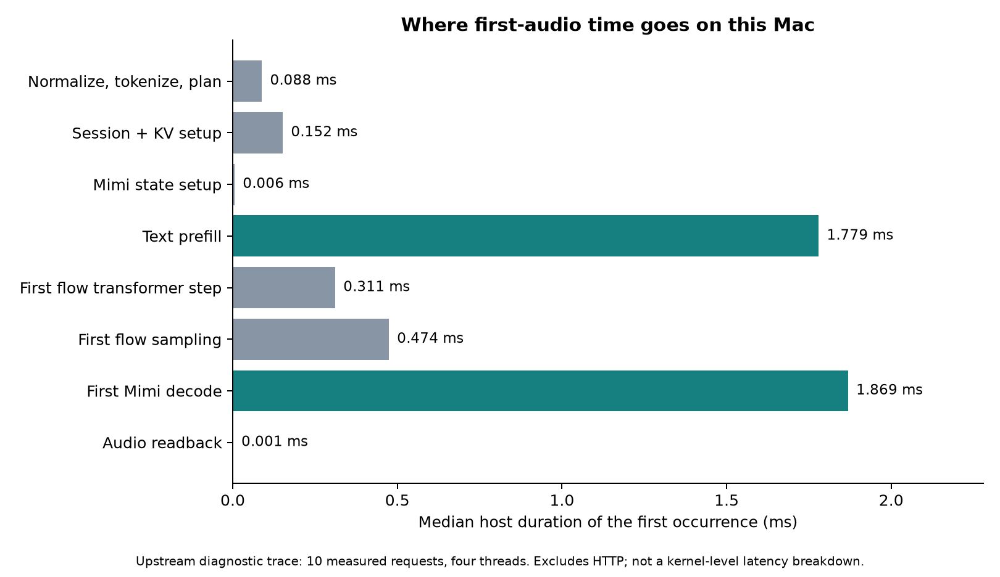
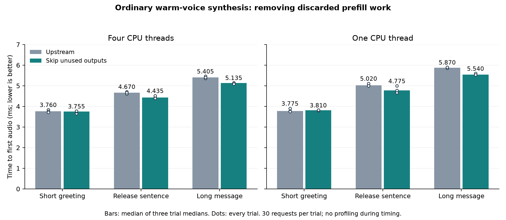

# Phonon first-audio investigation on Apple M4 Pro

The measured candidate removes unused computation from ordinary text prefill.
It lowers median time to first audio by approximately 5% on the medium and longer
texts tested here. The shortest text has no reliable improvement. This is an
incremental inference optimization, not a demonstrated breakthrough or a general
throughput increase.

Unlike the separate voice-cache LRU work, these runs keep one voice warm throughout.
The candidate starts from upstream `31e4e9f80275e432b570e17f5ccbefa895eff109`, without
the LRU patch. Both binaries include the same inactive profiling instrumentation;
the baseline instrumentation commit is `d62c54c`.

## What changed, and why it is valid

`TTSModel::run_backbone_and_increment` originally ran the entire transformer and
discarded its output. This happens when populating caches for text or voice prompts.
In a pre-normalized causal transformer, the final layer's stored keys and values
depend on that layer's input, normalization, projection and RoPE. They do not depend
on the attention result or feed-forward output computed afterwards.

The new `StreamingTransformer::prefill` therefore runs the earlier layers normally,
then stops the last flow-LM layer after storing its keys and values. Normal decode
still executes the entire layer. Mimi's forward path is unchanged. No model weights,
quantization settings, sampling settings, context lengths or speech content change.
This is removal of mathematically unused work, not an approximation or a claim of
a new attention algorithm. It retains the existing QKV projection and RoPE operations
to minimize numerical and implementation changes.

## Where the time goes



The original normal `Synth::stream` path was traced on the release-post sentence.
The median host TTFA was about 4.8 ms. Text prefill took 1.779 ms; the first Mimi
decode took 1.869 ms; the first flow transformer step and sampler took 0.311 and
0.474 ms. Session setup took 0.152 ms, including 0.145 ms for KV allocation/copy.
Normalization/tokenization/planning took 0.088 ms. These are diagnostic host spans,
not GPU timings or HTTP TTFA. The trace contains ten measured requests after three
warmups. See [all stage samples](baseline-stages.json). Inclusive/nested spans must
not be added together; scheduling gaps are not assigned to an operator.

An independent eight-second Instruments Time Profiler recording sampled the original
binary. After the first generation stack appeared, 27.66% of sampled CPU weight had
its leaf in Accelerate's `libBLAS`, 27.41% in the xn pool-worker function, 8.48% in
the fused CPU decode-attention closure, and 4.12% in `memmove`.
[The exported summary](native-hotspots.json) includes the original symbols.
The pool result motivates investigating synchronization and spinning; it does not
prove that 27% of request latency can be removed. These are aggregate CPU samples
across threads and whole utterances, including warmup, not first-frame wall-time
fractions. Some BLAS symbols resolve only to addresses. This is not an instruction-
level, allocation-complete, power, or hardware-counter profile.

A second diagnostic trace of the candidate splits the unchanged Mimi decoder more
finely. It uses ten requests after three warmups, with four threads. These extra
spans add profiling overhead; do not compare its total to the untraced benchmark.

| First-frame component | Median host time |
|---|---:|
| Latent upsampling | 0.016 ms |
| Mimi transformer and projection | 0.886 ms |
| Waveform decoder, inclusive | 1.030 ms |
| ↳ Initial convolution | 0.326 ms |
| ↳ Upsampling/residual stage 0 | 0.236 ms |
| ↳ Upsampling/residual stage 1 | 0.191 ms |
| ↳ Upsampling/residual stage 2 | 0.213 ms |
| ↳ Final convolution | 0.033 ms |

See [the per-request decoder samples](candidate-decoder-stages.json). Indented
rows are children of the waveform decoder and must not be added to it. The small
remaining time includes operations outside these child spans and instrumentation.

## Final timing results



Each cell below is the median of three per-trial statistics. Every trial has 30
measured requests after five warmups, in a fresh process; variant order alternates
and text order rotates. There are 1,080 measured requests and 180 warmups in the
final one-thread and four-thread matrices, all successful. No tracing, sampling
profiler, audio capture, or compilation ran during these timed matrices.

| CPU threads | Text | TTFA p50, original → candidate | Change | TTFA p95, original → candidate |
|---|---|---:|---:|---:|
| 4 | Short greeting | 3.760 → 3.755 ms | −0.1% | 4.20 → 4.14 ms |
| 4 | Release sentence | 4.670 → 4.435 ms | −5.0% | 5.35 → 4.77 ms |
| 4 | Long message | 5.405 → 5.135 ms | −5.0% | 6.00 → 6.16 ms |
| 1 | Short greeting | 3.775 → 3.810 ms | +0.9% | 4.23 → 4.09 ms |
| 1 | Release sentence | 5.020 → 4.775 ms | −4.9% | 5.39 → 5.08 ms |
| 1 | Long message | 5.870 → 5.540 ms | −5.6% | 6.28 → 5.90 ms |

The short-prompt result is mixed across trials and thread counts. The four-thread
long-text p95 regresses slightly. There is no uniform tail-latency improvement.
The exploratory prototype matrix is excluded from these final numbers.

Full-generation p50 is also mixed: four-thread short/medium/long changes are
32.43→32.845, 73.91→72.88 and 219.17→216.50 ms; one-thread changes are
37.12→37.99, 90.18→88.76 and 264.475→264.715 ms. This is primarily a prefill/TTFA
change, not evidence of a substantial RTFx increase.

Raw per-request observations, commands, binary SHA-256 hashes, exact texts, every
trial and process stdout are retained in [four-thread results](final-4threads/results.json)
and [one-thread results](final-1thread/results.json). `bench --per-iter` prints
latencies to 0.01 ms; a median of two middle observations can therefore end in
0.005 ms. [The manifest](manifest.json) pins the checkpoint and upstream baseline.

Hardware/software: Apple M4 Pro, 12 logical CPUs, 24 GiB RAM, macOS 27.0.1;
Rust 1.92.0; release build with `hf,accelerate,kai`, native CPU target; Phonon
31m English q8 weights, default voice, temperature 0.3, seed 42. Native `Synth`
timing includes normal text preparation and streaming delivery to the caller,
but excludes initial model loading and one-off voice conditioning. Long input
uses the existing text chunking rules. This is an interactive desktop without
thermal/clock isolation, not production traffic or an HTTP service capacity test.
Results are for this checkpoint and hardware; CUDA/Metal and other models were not
benchmarked. No GPU cloud resources were used.

## Output preservation

The synthetic regression test compares every layer's full K/V buffers and subsequent
decode outputs exactly for multi-head and grouped-query attention (1, 2 and 4 KV
heads), across repeated prefixes and nonzero position offsets. The real-checkpoint
test does the same with Phonon q8 weights. It passed with four-thread KleidiAI enabled
and with one thread and `XN_KAI=0`.

Separate waveform checks cover five sentences, one and four CPU threads, and an
independent repeat of the original binary for each comparison. All ten candidate
comparisons have matching durations and finite audio. The worst maximum absolute
float32 sample difference is 2.40e-6 and the lowest signal-to-error ratio is 120.19 dB.
Original-vs-original repetitions also differ at this small numerical scale, consistent
with the runtime's opportunistic decoder batching. Complete audio is not bit-identical.
These are waveform checks, not MOS, WER or a broad human-listening evaluation.

- [One-thread waveform results](audio-1thread/report.json)
- [Four-thread waveform results and baseline-repeat controls](audio-4threads/report.json)
- [Original audio: “Hey Gradium team…”](audio-4threads/sample-baseline.wav)
- [Candidate audio: the same phrase](audio-4threads/sample-candidate.wav)

The WAVs are 24 kHz mono PCM16 conversions of the saved float32 outputs with identical
conversion; no normalization or post-processing was added for the comparison.

## Research priorities after this result

1. **Incremental delivery inside the first Mimi frame.** It accounts for about
   1.9 ms in the host trace, split between the transformer and waveform decoder as
   measured above. This checkpoint emits an 80 ms latent frame: the codec upsamples
   it to 16 internal timesteps, each corresponding to 5 ms of waveform. Investigate
   decoding four internal timesteps first to emit 20 ms of playable PCM, then finishing
   the remainder through the same streaming states. The experiment must compare time
   to the first 20 ms, time to the first 80 ms, first non-silent audio, audio equivalence,
   inter-chunk deadlines and total generation time. Receiving a smaller header or a
   fragment too short to play is not a valid improvement. Smaller matrix operations
   and contention after releasing the first-frame rendezvous may hurt throughput;
   no gain has been demonstrated for this candidate yet.
   An illustrative 50% reduction in this decoder portion before first playable audio would save about
   0.95 ms, or roughly 20% of the traced TTFA. That is a sensitivity estimate, not an
   achieved or predicted speedup.
2. **Fuse text prefill with the first audio-token step.** Causal attention may allow
   those operations to share a pass. The final layer could compute all required K/V
   entries but only the output query that is actually consumed. This needs separate
   implementation and quality tests: moving a token from a decode matrix-vector
   operation to a batched KleidiAI matrix operation can change numerical behavior.
3. **Scheduling for small kernels.** Profile pool handoffs and the first-frame
   rendezvous with request-correlated traces. Measure latency and CPU use together;
   removing spinning can increase wakeup latency. No thread-budget sweep is offered
   here as the core contribution.

One narrower idea was deprioritized analytically: skipping known-zero inputs in the
initial waveform convolution. Its seven-tap causal kernel processes 16 timesteps
in the first frame. Only 21 of 112 temporal tap positions are initial padding,
roughly 19% of that convolution's work. Even a proportional saving in its measured
0.326 ms would be about 0.06 ms overall, before accounting for packing, dispatch
and memory costs. That is a weak first target compared with the full first-frame
delivery path; no speedup is claimed or implementation proposed for it here.

Existing upstream work must be considered before proposing overlapping changes:
[time conditioning reuse #296](https://github.com/gradium-ai/xn-ptts/pull/296),
[flow CUDA graphs #297](https://github.com/gradium-ai/xn-ptts/pull/297),
[Mimi CUDA overlap #294](https://github.com/gradium-ai/xn-ptts/pull/294), and
[Mimi CUDA graphs #298](https://github.com/gradium-ai/xn-ptts/pull/298).
Those CUDA results are their authors' measurements, not results of this Mac study.

## Reproduce

From the repository, build the baseline instrumentation commit and this candidate
with the same toolchain/features, saving each binary outside Cargo's target directory:

```sh
cargo build --locked --release -p ptts --example bench --features hf,accelerate,kai
```

The experiment root used by the scripts holds `models/phonon-31m-en/`, including
`config.json`, `tokenizer.json`, `model.q8.gguf` and `default-voice.safetensors`.
Use new output directories; the scripts refuse to replace an existing study.

```sh
python3 scripts/compare-ttfa.py --root EXPERIMENT_ROOT \
  --baseline BASELINE_BINARY --candidate CANDIDATE_BINARY \
  --out NEW_OUTPUT_DIRECTORY --threads 4
python3 scripts/check-ttfa-audio.py --root EXPERIMENT_ROOT \
  --baseline BASELINE_BINARY --candidate CANDIDATE_BINARY \
  --out NEW_AUDIO_DIRECTORY --threads 4
```

For host attribution, add `--trace-json TRACE.json` to a normal `bench` call, then
run `scripts/summarize-ttfa-trace.py TRACE.json`. Do not use `--breakdown` as a
substitute: it serializes execution and is not the production streaming path.
`--pcm-output` is for separate output checks only; recording samples adds work within
generation even though file writing is outside the timed region.

Native sampling used `xctrace record --template 'Time Profiler' --time-limit 8s
--output RECORDING.trace --launch -- BASELINE_BINARY ...` with enough iterations
to outlast the recording. Export the `time-profile` table and run
`scripts/summarize-time-profile.py EXPORT.xml`. The full recording and host trace
are retained in the local experiment's `results/ttfa-rnd/` directory rather than
committed as large binary artifacts.

Validation: 142 regular tests/doctests passed, plus the opt-in real-checkpoint test
in the two configurations above. Formatting and Clippy passed; Clippy exempts only
the pre-existing upstream `clippy::nonminimal_bool` warning in `preprocess.rs` via
the command line, with no source suppression. See the study's source and scripts
for the exact scope; no CUDA execution, Metal execution or listening study is implied.
