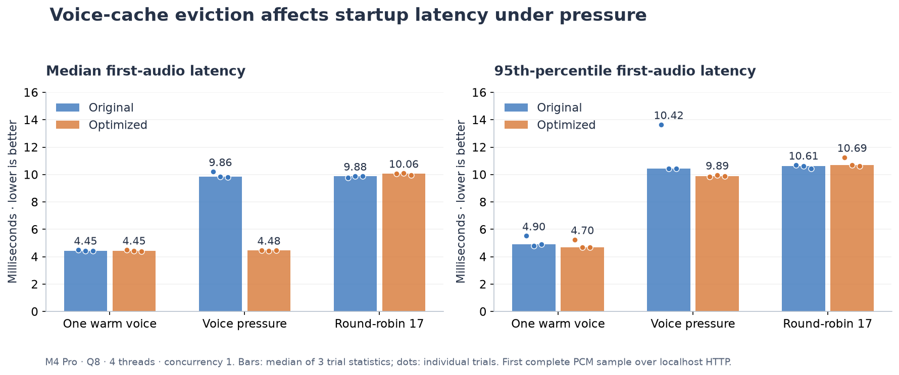
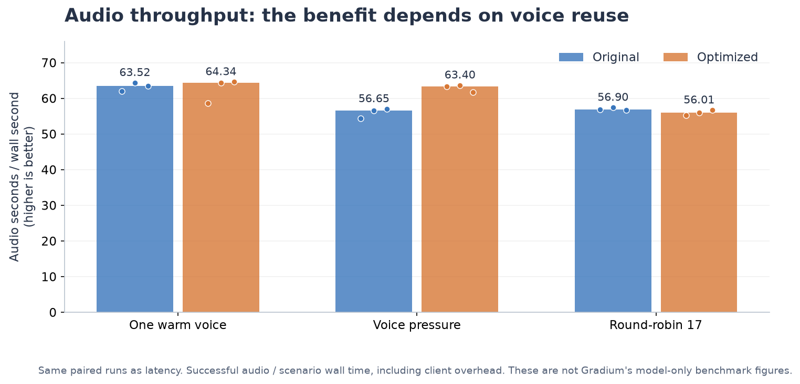
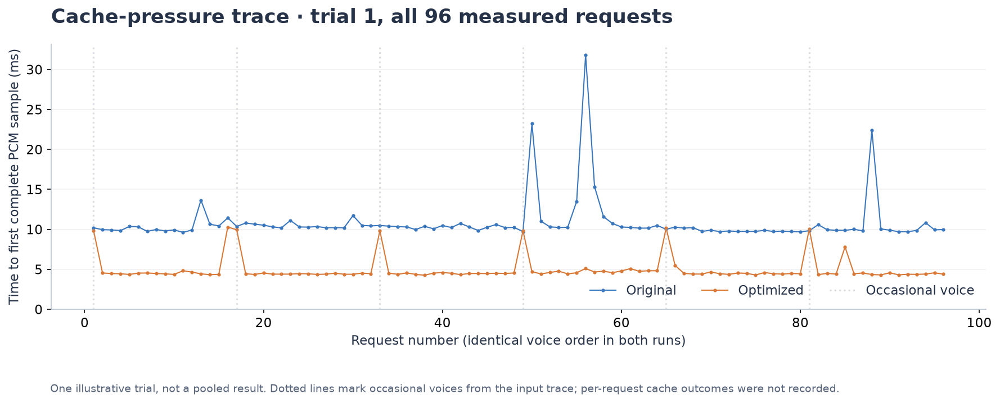
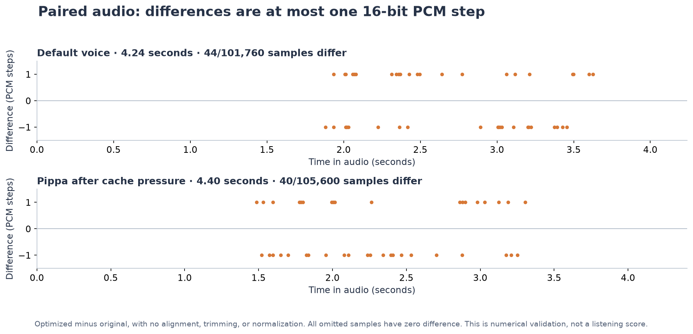

# Phonon voice-cache comparison: graphs and paired audio

Replacing clear-all eviction with bounded LRU retention improved first-audio latency
when occasional voices interrupted a frequently reused voice set. The single-voice
control was unchanged, and round-robin access to 17 voices did not benefit.

This is a serving-cache experiment on Phonon 31m English. Gradium's
[release post](https://gradium.ai/blog/release-phonon-open-weight) reports synthesis
latency excluding initial voice conditioning. Here, HTTP requests include any
conditioning required after a cache miss. Hardware, text and measurement boundaries
also differ, so these figures must not be presented as a win over the release post.

## First audio and throughput





Bars show the median of three per-trial statistics; dots show every trial.
The p95 labels are medians of trial p95 values, not pooled percentiles. There are
1,764 measured requests and 204 warm-ups across the paired runs, with zero errors.

| Workload | First-audio p50, original → optimized | Audio seconds/wall second, original → optimized |
|---|---:|---:|
| One warm voice | 4.445 → 4.445 ms | 63.52 → 64.34 |
| Controlled voice pressure | 9.856 → 4.479 ms (−54.6%) | 56.65 → 63.40 (+11.9%) |
| Round-robin 17 voices | 9.882 → 10.057 ms | 56.90 → 56.01 |

The pressure workload deliberately uses 15 frequent voices plus two alternating
occasional voices around a 16-entry capacity. It is not a production traffic sample.
Small control differences are not statistically established gains or regressions.

## Why the requests behave differently



The trace shows every request from the first pressure trial, without trimming slow
requests. Dotted lines mark occasional-voice arrivals from the workload. They do
not establish the cause of every latency spike. The optimized server recorded
89 hits, 7 misses and 7 evictions over that measured run. Upstream cache counts
were not instrumented; per-request hit/miss flags were not recorded.

## Listen to the same sentence

> Hey Gradium team, this is Rudraksh loving the phonon so far!

Both variants use the same model, request sequence, temperature (0.3), seed (42),
voice and CPU options. WAVs contain unmodified 24 kHz mono signed 16-bit PCM:
no trimming, alignment, loudness normalization or speed adjustment.

| Scenario | Original | Optimized | Duration in each file |
|---|---|---|---:|
| Default voice | [Download WAV](audio/original-default.wav) | [Download WAV](audio/optimized-default.wav) | 4.24 s |
| Pippa after cache pressure | [Download WAV](audio/original-cache-pressure.wav) | [Download WAV](audio/optimized-cache-pressure.wav) | 4.40 s |

For embedded audio players, download this `showcase` folder and open
[index.html](index.html) locally. The page, graphs and audio require no API key
or inference server. GitHub displays this README; it does not render the HTML
page as a website.



Each pair has the same sample count. The maximum difference is one PCM step
(1/32768 of normalized full scale): 44 of 101,760 samples differ for the default
voice, and 40 of 105,600 for Pippa. Both are below 0.05% of samples. These are
numerical comparisons, not naturalness, intelligibility or speaker-similarity
scores. No ASR/WER or blinded listening evaluation was performed.
[Sample metadata and numerical report](audio/report.json).

These four audio files are a separate sample check; their one-shot latency values
are not included in the repeated benchmark graphs above.

## Provenance and reproduction

- Apple M4 Pro, 12 logical CPUs, 24 GiB RAM; macOS 27.0.1; CPU Q8;
  `accelerate,kai`; `RAYON_NUM_THREADS=4`, `XN_KAI=1`, concurrency 1.
- Original runtime: `31e4e9f80275e432b570e17f5ccbefa895eff109`.
- Optimized runtime: `df6aeaa68d318c9ec5684dc6658eb8c0b5304ece` (core change
  `bf6beea` and server controls `817035d`; subsequent commits are benchmark/docs).
- Model: `gradium/phonon-31m-en@92741c5b07d085ff840e26fea8ce43110b87852f`.
- Voices: `gradium/phonon-voices@da6c9ec0d47be8df5c87c730a3aa97187f3229c3`.
- [Full method and per-trial exports](../README.md), [environment](../environment.json),
  [asset hashes](../assets.json), [earlier numerical comparison](../pcm-parity.json).
- [Separate AIPerf complete-response measurements](../../../../aiperf/results/m4-pro-2026-11-01/README.md).
  Those measurements are not combined with the PCM harness's first-audio timings.

Re-render the PNG and SVG charts from the checked-in evidence:

```sh
uv run --with matplotlib==3.11.1 --with numpy python generate_figures.py
```

Recreate the audio into a new output folder, using the saved `binaries/` and
`models/` layout described by the experiment's reproduction guide:

```sh
uv run --with numpy python capture_samples.py /path/to/experiment /path/to/new-audio-output
```

The retained-KV budget does not cap total process RAM or active request memory.
These shared-desktop tests do not establish GPU performance, production tail
latency, sustainable load, energy savings or broad perceptual quality.
